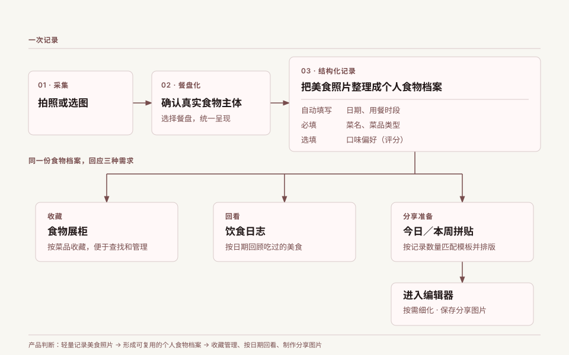
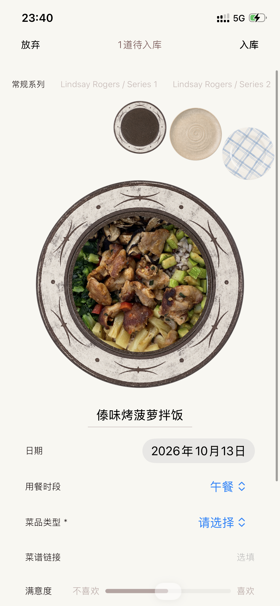
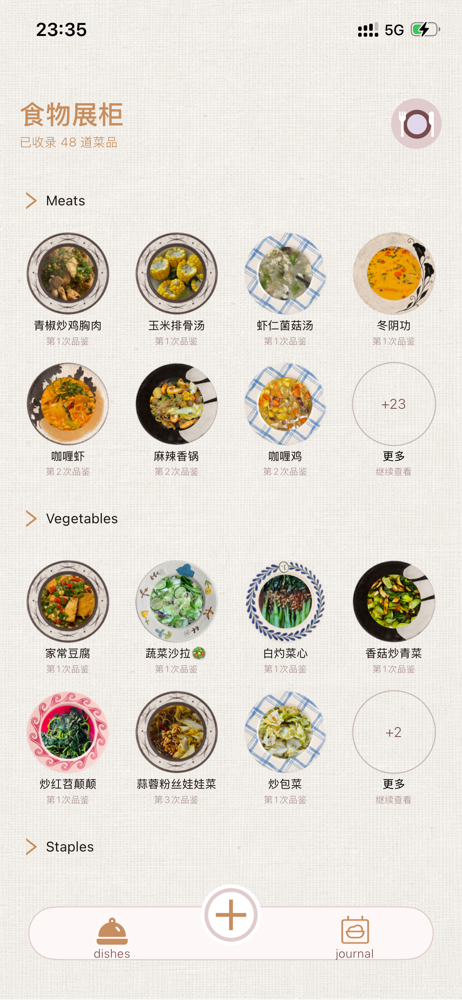
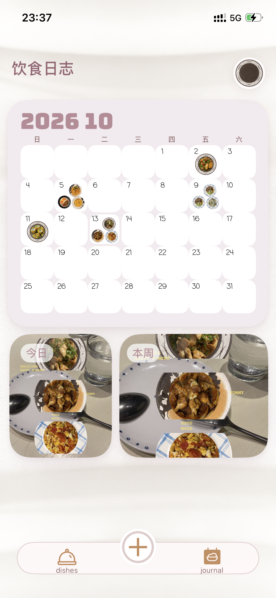
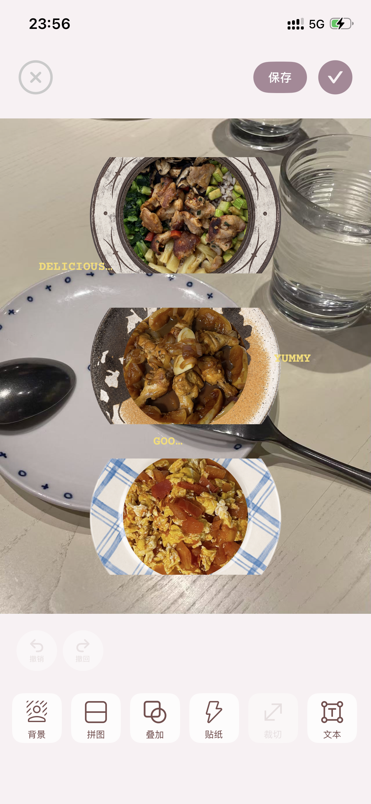
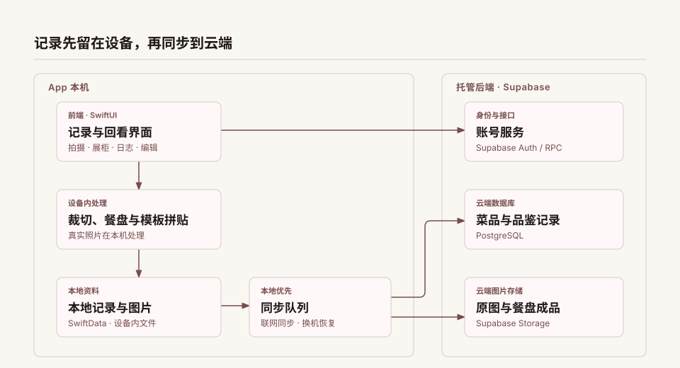

# Mi味｜把每一道菜整理成自己的食记

Mi味是一款为喜欢记录美食、却不想花时间整理照片的人设计的 App。

**拍下一道菜 → 放进餐盘 → 按菜品和日期回看 → 自动排版成分享图片**

它降低了记录时对拍摄环境的要求，让零散照片成为个人食记，也解决了分享前不会排版的难题。

## 项目概况

- **项目方式：** 个人独立完成，从产品定义、交互与视觉设计，到开发、真机验收和 TestFlight 内测。
- **当前阶段：** 内部 TestFlight 真机验收中。
- **实现与源码：** [查看 Mi味 App 源码与技术结构](https://github.com/menziiiii2026-ctrl/miwei-app-source)。

## 为什么做

这个项目从一个日常场景出发：很多人习惯拍美食，却很少整理拍下的照片。照片留在相册里，想找某道菜、回看某天吃了什么，或挑选照片分享，都要重新翻找和编排。Mi味把整理融入记录：用餐盘画面降低对拍摄环境的要求，补充菜名等信息形成个人食记；之后既能按菜品查找、按日期回看，也能将积累的照片自动排版成适合分享的图片。一次记录，回应收藏管理、日常回顾和图片分享三种需求。

## 核心体验

拍下食物、放进餐盘，再补上菜名和类型，就完成一次记录。同一份记录可以按菜品收藏、按日期回看；积累的照片还可以按数量匹配预设模板，排版成今日或本周的分享图片。

## 真实界面

以下为当前 App 的真机截图，依照「记录 → 收藏 → 回看 → 创作」排列。

| 01 · 餐盘化记录 | 02 · 食物展柜 |
| :---: | :---: |
|  |  |
| 食物放入餐盘后，补充菜名与类型。 | 按菜品浏览，积累同一道菜的多次记录。 |

| 03 · 饮食日志 | 04 · 拼贴编辑 |
| :---: | :---: |
|  |  |
| 按日期回看；今日、本周卡片进入拼贴。 | 调整画面，保存可分享的图片。 |

## 三个关键产品选择

| 选择 | 原因与取舍 |
| --- | --- |
| 记录时只补充必要信息 | 日期和用餐时段按照片时间预填，菜名与类型必填；满意度、口味、健康度、新鲜感选填。先让记录容易完成，也为未来‘今天吃什么’的个人 AI 推荐助手预留数据入口。 |
| 一份记录服务于三种需求 | 同一份食物记录用于按菜品收藏、按日期回看，以及制作今日／本周拼贴。一次记录，回应三种不同场景的需求。 |
| 系统先排版，用户按需编辑 | 系统按今日／本周的记录数量匹配模板，自动拼出可直接保存的图片；想进一步表达时，用户再进入编辑器调整。分享前的主要排版由系统完成。 |

详细的选择理由与待验证问题，见[产品决策](docs/product-decisions.md)。

## 系统架构

记录和图片先保存在本机，再通过同步队列进入 Supabase，供账号恢复使用；今日／本周拼贴则在本机按预设模板生成。

## 当前进展与后续方向

Mi味已进入内部 TestFlight 真机测试。目前确认原有菜品保留、新增菜品可立即出现在食物展柜；账号与图片恢复、编辑等流程仍在逐项回归。具体范围见[测试与学习](docs/testing-and-learning.md)。

近期先完成核心流程的真机验收。此后希望沿两个方向继续发展：

- **从记录到饮食建议：** 现在先积累菜品、用餐时间和可选的口味评价，逐步形成个人口味档案。未来探索用 AI 结合这些记录与偏好，提供‘今天吃什么’的个性化建议。当前版本尚未提供这项 AI 能力。
- **从预设模板到个人模板：** 目前由系统按记录数量匹配预设模板，自动完成拼贴。未来探索让用户上传喜欢的版式，将其拆解为可编辑的分层模板，保存并重复使用。
